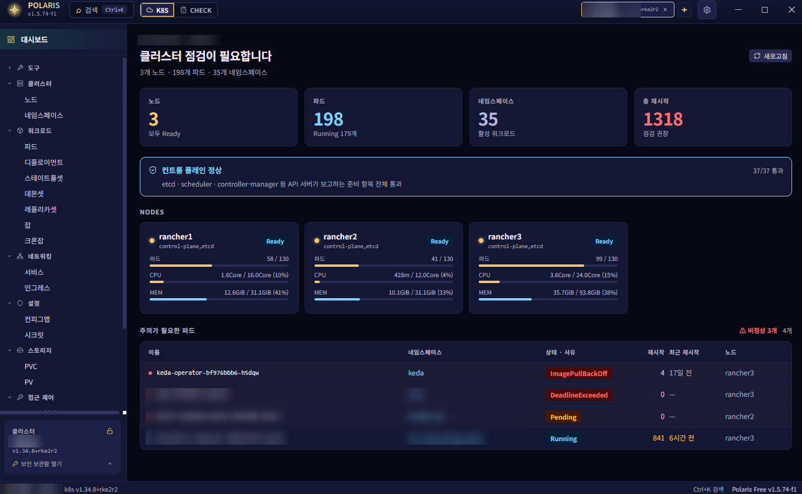
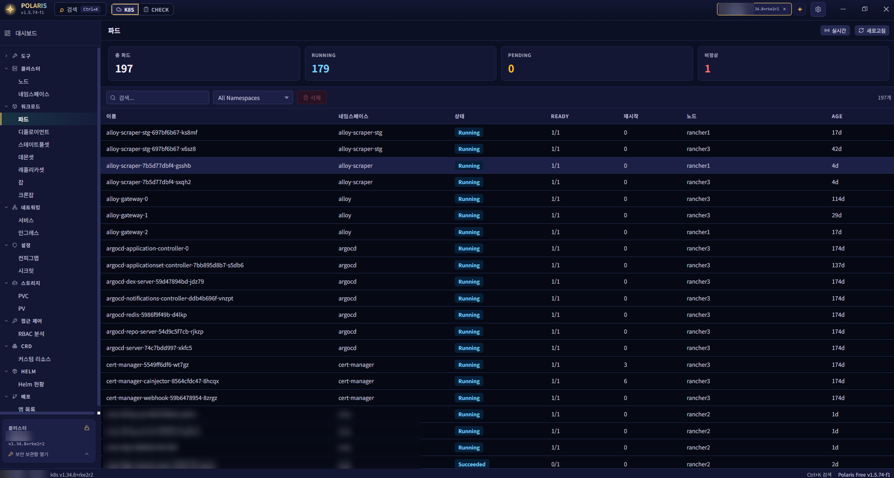
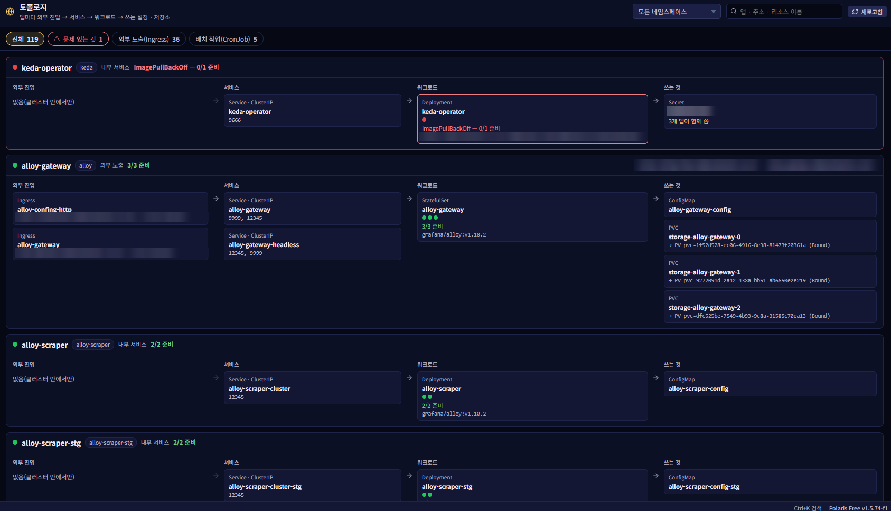
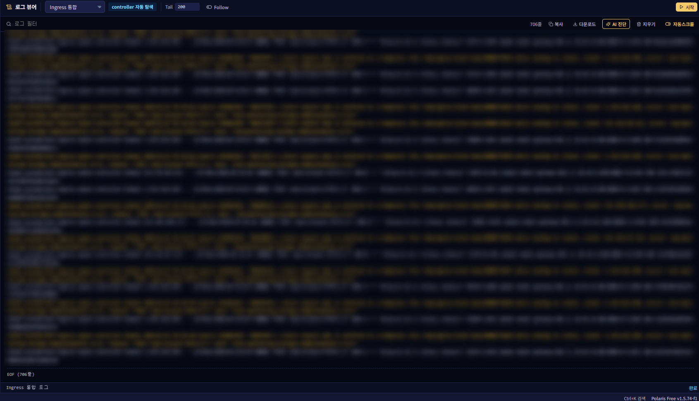
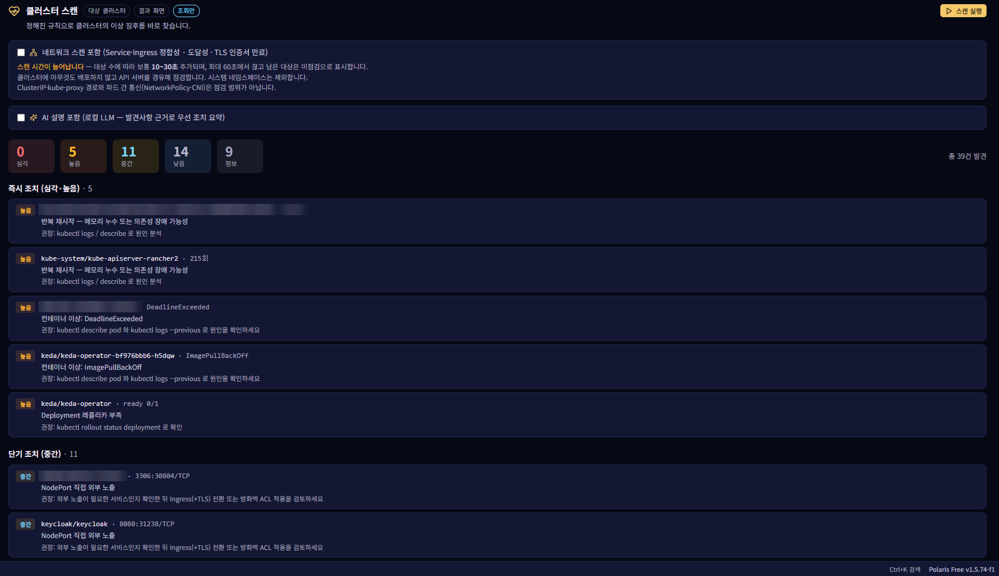
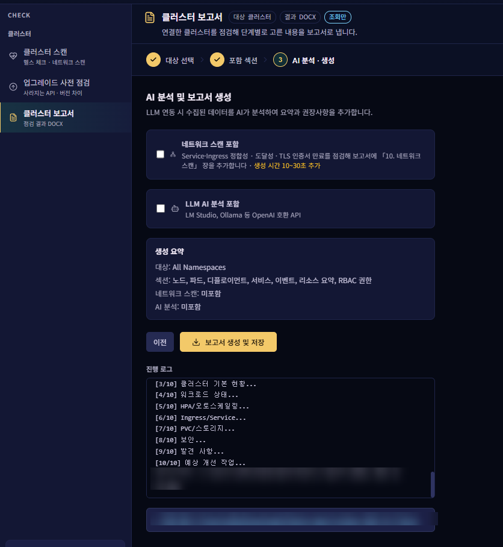
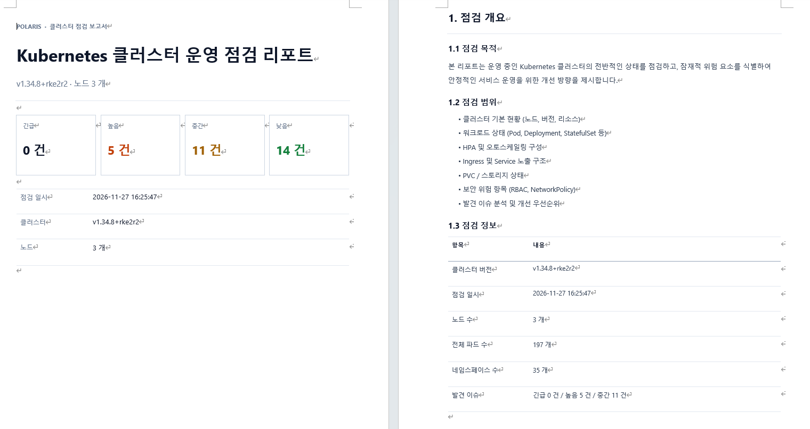

<p align="center">
  
</p>

<h3 align="center">Windows 에서 쓰는 쿠버네티스 클러스터 관리 도구 — 무료판</h3>

<p align="center">
  여러 클러스터를 탭으로 오가며 리소스 · 로그 · 이벤트를 보고, 클러스터 점검 · 업그레이드 사전 점검 · 보고서를 만듭니다.<br>
  kubeconfig 는 이 PC 의 보안 보관함에만 암호화해 둡니다.
</p>

<p align="center">
  
  
  
  
  
</p>

<p align="center">
  <a href="#다운로드">다운로드</a> ·
  <a href="#한눈에-보기">한눈에 보기</a> ·
  <a href="#화면">화면</a> ·
  <a href="#주요-기능">주요 기능</a> ·
  <a href="#보안">보안</a> ·
  <a href="#쿠버네티스-호환성">호환성</a> ·
  <a href="#문제-해결">문제 해결</a> ·
  <a href="#개발--빌드">개발</a>
</p>

<p align="center">
  
</p>

---

## 다운로드

| 구분 | 버전 | 다운로드 | 릴리스 노트 | 환경 |
|------|------|------|------|------|
| **최신** | **v1.5.74-f1** | [설치 파일 (.exe)](https://github.com/forestian/polaris/releases/download/v1.5.74-f1/polaris-setup-win64.exe) | [v1.5.74-f1 노트](https://github.com/forestian/polaris/releases/tag/v1.5.74-f1) | Windows 64-bit |

- **설치** — `polaris-setup-win64.exe` 하나로 끝. 언어(한/영) → 위치 → 바로가기 · 자동 실행 → 설치 로그 → 완료. 사용자 폴더(`%LocalAppData%\Programs\Polaris Free`)에 설치돼 **관리자 권한이 필요 없고**, 제어판에서 제거할 수 있습니다.
- **데이터** — 설정 · 보안 보관함 · 스냅샷은 `%USERPROFILE%\.polaris-free` 에 둡니다. 다시 설치하거나 제거해도 지우지 않습니다.
- **무결성 확인** — 릴리스의 `.sha256` 을 같은 폴더에 받아 `sha256sum -c polaris-setup-win64.exe.sha256` (→ `OK`).
- **새 판** — 앱 안 업데이트는 없습니다. 새 설치 파일을 받아 다시 설치하면 설정 · 보관함은 그대로 남습니다.
- **첫 실행** — 코드 서명 전이라 SmartScreen 「알 수 없는 게시자」 가 보일 수 있습니다 → **추가 정보 → 실행**.
- 모든 판은 [GitHub Releases](https://github.com/forestian/polaris/releases), 변경 내역은 [CHANGELOG.md](./CHANGELOG.md) 에 있습니다.

---

## 한눈에 보기

상단 탭은 두 개입니다.

| 탭 | 하는 일 | 대표 기능 |
|:---:|---|---|
| **K8S** | 쿠버네티스 클러스터 관리 | 멀티클러스터 탭 · 대시보드 · 리소스 브라우저 · 토폴로지 · 로그 · 이벤트 · 스냅샷 비교 · YAML 실험실 · 포트 포워딩 · k9s · kubectl 터미널 |
| **CHECK** | 클러스터 점검 | 클러스터 스캔 · 업그레이드 사전 점검 · 클러스터 보고서(DOCX) |

그 밖에 **AI 진단**(로그 · 이벤트 → 원인 · 조치 초안)과 **MCP 서버**(AI 클라이언트에 클러스터 조회만 허용)가 있습니다.

---

## 화면

> 클러스터 이름 · 주소 · 업무 워크로드 이름은 가렸습니다.

### K8S

| 파드 목록 | 토폴로지 |
|---|---|
|  |  |
| **로그 뷰어** (Ingress 통합) | **AI 진단** |
|  |  |

### CHECK

| 클러스터 스캔 | 업그레이드 사전 점검 |
|---|---|
|  |  |
| **클러스터 보고서** — 단계별로 골라 만들기 | **보고서(DOCX)** — 표지 · 점검 개요 |
|  |  |

---

## 주요 기능

### K8S

- **멀티클러스터** — 여러 kubeconfig · 컨텍스트를 탭으로. 클러스터마다 상태를 한 화면에 모아 보기
- **대시보드** — 노드 · 파드 · 네임스페이스 · 재시작 수, 컨트롤 플레인 준비 상태, 주의가 필요한 파드
- **리소스 브라우저** — 노드 · 네임스페이스 · 워크로드 · 네트워킹 · 설정 · 스토리지 · CRD/커스텀 리소스. 실시간 갱신(watch), YAML 보기 · 편집 · 적용, Scale · 재시작 · 롤백
- **토폴로지** — 앱 단위 카드로 Ingress → Service → 워크로드 → 파드 연결
- **로그 뷰어 · 이벤트** — 여러 파드 로그 묶어 보기 · 저장 · 복사, 이벤트 필터
- **스냅샷** — 클러스터 상태를 시점별로 저장(암호화)하고 두 시점 비교
- **YAML 실험실** — 매니페스트 붙여 넣기 · 버전 이력 · 적용 · 결과 관찰
- **RBAC 분석** — ServiceAccount 권한 역추적, 과도 권한 경고
- **Helm 현황 · Argo CD 앱 목록** — 조회
- **도구** — 포트 포워딩 · k9s · kubectl 터미널 · 파드 셸(앱 안에서)

### CHECK

- **클러스터 스캔** — 정해진 규칙으로 이상 징후를 바로 찾습니다(파드 · 노드 · 컨트롤 플레인 · 네트워크 스캔은 선택)
- **업그레이드 사전 점검** — 목표 판으로 올리기 전에 사라지는 API · drain 방해(PDB 등) · 애드온 호환 · 설치된 애플리케이션 위험을 확인. RKE2 업그레이드 경로 포함 · 결과를 글 · DOCX 로
- **클러스터 보고서** — 단계별로 고른 내용을 DOCX 운영 점검 보고서로(AI 의견 선택)

CHECK 는 **조회만** 합니다 — 클러스터를 바꾸지 않습니다.

### AI · MCP · 알림

- **AI 진단** — 로그 · 이벤트를 OpenAI 호환 LLM(로컬 LLM 포함)에 보내 원인 · 조치 초안을 받습니다. 보내기 전에 흔한 비밀값을 가립니다
- **MCP 서버** — Claude 같은 AI 클라이언트가 클러스터를 **조회만** 하게 합니다(툴 6종). MCP 액세스 토큰으로만 열리고 kubeconfig 는 AI 에 넘어가지 않습니다 — [docs/mcp.md](docs/mcp.md)
- **알림** — 클러스터 이벤트를 트레이 알림 · 웹훅(Slack 등)으로

---

## 보안

- **보안 보관함** — kubeconfig · 스냅샷을 **AES-256-GCM**(scrypt)으로 암호화. 시작할 때 잠금 해제(비밀번호 · **Windows Hello** · 이 PC 자동 잠금 해제 중 선택)
- **비밀은 화면으로 가지 않음** — kubeconfig 본문은 Python 안에서만 쓰고 WebView 로 넘기지 않음
- **데이터 폴더 보호** — 현재 Windows 사용자만 읽도록 권한 제한, 온라인 전송 없음
- **MCP** — 접속 정보는 AI 에 넘기지 않고 결과만 반환. 조회 툴만 있고 모든 호출을 감사 로그에(비밀 인자는 가림)

---

## 쿠버네티스 호환성

| 판 | 상태 |
|---|---|
| **1.37** | Rancher Desktop(k3s) 1.37.2 연결 · 조회 확인 |
| **1.33 ~ 1.36** | 권장 범위 — RKE2 · k3s 실사용 검증 |
| **1.25 ~ 1.32** | 코어 기능 정상(v1 안정 API 만 사용) |
| 1.24 이하 | 확인하지 않음 |

- Polaris 는 CoreV1 · AppsV1 · BatchV1 · NetworkingV1 · RbacV1 · StorageV1 · AutoscalingV1 · PolicyV1 안정 API 만 씁니다.
- kubectl 은 클러스터마다 판이 가장 가까운 것을 골라 씁니다. 없으면 연결할 때 공식 kubectl 을 받아 둡니다(체크섬 확인).

---

## 문제 해결

<details>
<summary><b>클러스터에 연결되지 않습니다</b></summary>

- kubeconfig 경로와 고른 컨텍스트를 확인하세요. VPN · 프록시 · 인증서도 함께
- API 서버에 직접 닿는지: `kubectl cluster-info`

</details>

<details>
<summary><b>CPU · 메모리 그래프가 비어 있습니다</b></summary>

파드 · 노드 지표는 `metrics.k8s.io`(metrics-server)가 있어야 보입니다.

</details>

<details>
<summary><b>보안 보관함 비밀번호를 잊었습니다</b></summary>

복구할 수 없습니다(보관한 kubeconfig · 스냅샷도 열 수 없음). 초기화하려면 `%USERPROFILE%\.polaris-free\vault.json` 을 지우고 다시 시작하세요 — 보관 항목은 모두 사라집니다.

</details>

<details>
<summary><b>SmartScreen 경고가 뜹니다</b></summary>

GitHub Releases 에서 받은 파일인지(체크섬) 확인한 뒤 **추가 정보 → 실행**.

</details>

---

## 개발 · 빌드

```bash
# 화면 개발 서버
cd ui && npm install && npm run dev

# 시험
python -W ignore -m unittest discover -s tests -q
cd ui && node --test src/*.test.mjs

# 빌드(빌드 전 점검 · 시험 → PyInstaller → 설치 파일)
python build.py
# → dist/polaris-setup-win64.exe
```

| 영역 | 사용 |
|---|---|
| 화면 | React 18 · Vite · xterm.js |
| 백엔드 | Python 3.13 · kubernetes client · pywebview(WebView2) · cryptography |
| 설치기 | Tauri(전용 설치 마법사) |
| 빌드 | PyInstaller(onedir) → 단일 설치 exe |

**디자인** — 미드나잇 인디고 바탕 · Polestar Gold(`#f3c969`) 강조 · 8각 북극성 로고. 테마 여러 개 · 직접 만드는 테마 지원.

---

## 라이선스 · 보안

- [MIT License](./LICENSE) · 함께 들어 있는 오픈소스 구성 요소의 고지는 설치 폴더의 `THIRD_PARTY_NOTICES.txt`
- 보안 문제는 [SECURITY.md](./SECURITY.md) 의 방법으로 알려 주세요.

---

## English

**Polaris** is a Windows desktop app for managing Kubernetes clusters (free edition).

- **K8S** — multi-cluster tabs, dashboard, resource browser (live watch · YAML edit/apply · scale · restart · rollback),
  app-level topology, log viewer, events, encrypted snapshots with diff, YAML lab, RBAC analysis, Helm/Argo CD views,
  port forwarding, k9s and an in-app kubectl terminal / pod shell
- **CHECK** — cluster scan, upgrade pre-check (removed APIs · drain blockers · add-on compatibility · RKE2 path) and a DOCX cluster report — read-only
- **AI diagnosis** of logs/events with any OpenAI-compatible LLM (local LLMs included), secrets are masked before sending
- **MCP server (read-only, 6 tools)** — let AI clients such as Claude query your clusters without ever seeing kubeconfigs ([docs/mcp.md](docs/mcp.md))
- kubeconfigs and snapshots are stored encrypted (AES-256-GCM) in a local vault — master password, Windows Hello or per-PC auto unlock

Download the installer from [Releases](https://github.com/forestian/polaris/releases). Per-user install, no admin rights required. Kubernetes 1.25 – 1.37.
