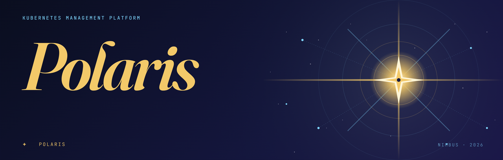
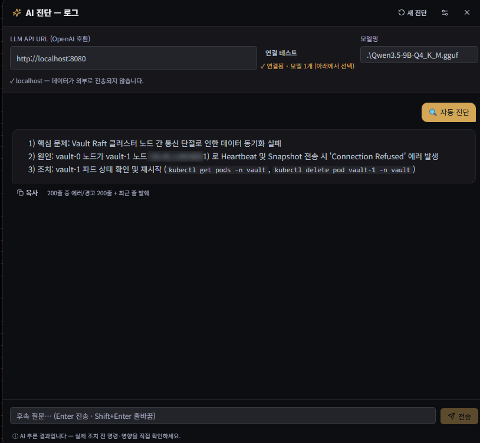
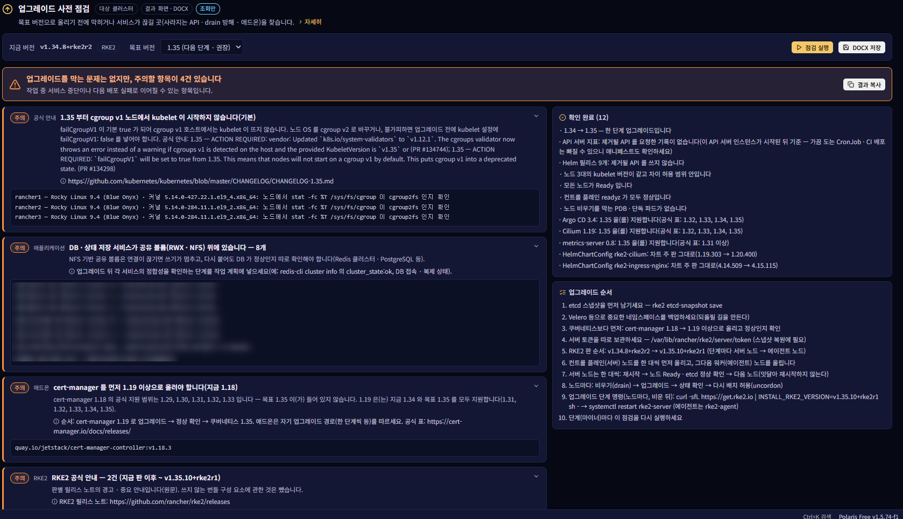

<div align="center">



# POLARIS

### Kubernetes Cluster Management GUI for Windows

**Free Edition — K8S + CHECK** · v1.5.74-f1

[](https://github.com/forestian/polaris/releases/latest)
[](https://github.com/forestian/polaris)
[](#-download)
[](./LICENSE)
[](#-kubernetes-호환성)
[](./docs/mcp.md)
[](#-주요-기능)
<br>
[](#-개발--빌드)
[](#-개발--빌드)
[](./SECURITY.md)
[](https://github.com/forestian/polaris/releases/latest)
[](https://github.com/forestian/polaris/actions/workflows/ci.yml)

[**한국어**](#-한국어) · [**English**](#-english)


</div>

---

<a id="-한국어"></a>

<details open>
<summary><h2>🇰🇷 한국어</h2></summary>

### Polaris 란?

Windows 에서 쓰는 **쿠버네티스 클러스터 관리 데스크톱 앱**입니다. kubeconfig 로 여러 클러스터를 탭으로 오가며
리소스 · 로그 · 이벤트를 보고, **클러스터 스캔 · 업그레이드 사전 점검 · DOCX 보고서**를 만듭니다.
kubeconfig 는 이 PC 의 **암호화 보안 보관함**에만 둡니다. 파이썬 · Node.js 설치 없이 설치 파일 하나로 끝납니다.

| 탭 | 하는 일 | 대표 기능 |
|:---:|---|---|
| **K8S** | 쿠버네티스 클러스터 관리 | 멀티클러스터 탭 · 대시보드 · 리소스 브라우저 · 토폴로지 · 로그 · 이벤트 · 스냅샷 비교 · YAML 실험실 · 포트 포워딩 · k9s · kubectl 터미널 |
| **CHECK** | 클러스터 점검(조회만) | 클러스터 스캔 · 업그레이드 사전 점검 · 클러스터 보고서(DOCX) |

그 밖에 **AI 진단**(로그 · 이벤트 → 원인 · 조치 초안)과 **MCP 서버**(AI 클라이언트에 클러스터 조회만 허용)가 있습니다.

<a id="-download"></a>

### 다운로드

| 구분 | 버전 | 다운로드 | 릴리스 노트 | 환경 |
|------|------|------|------|------|
| **최신** | **v1.5.74-f1** | [설치 파일 (.exe)](https://github.com/forestian/polaris/releases/download/v1.5.74-f1/polaris-setup-win64.exe) | [v1.5.74-f1 노트](https://github.com/forestian/polaris/releases/tag/v1.5.74-f1) | Windows 64-bit |

- **설치** — `polaris-setup-win64.exe` 하나로 끝. 언어(한/영) → 위치 → 바로가기 · 자동 실행 → 설치 로그 → 완료. 사용자 폴더(`%LocalAppData%\Programs\Polaris Free`)에 설치돼 **관리자 권한이 필요 없고**, 제어판에서 제거할 수 있습니다.
- **데이터** — 설정 · 보안 보관함 · 스냅샷은 `%USERPROFILE%\.polaris-free` 에 둡니다. 다시 설치하거나 제거해도 지우지 않습니다.
- **무결성 확인** — 릴리스의 `.sha256` 을 같은 폴더에 받아 `sha256sum -c polaris-setup-win64.exe.sha256` (→ `OK`).
- **새 판** — 앱 안 업데이트는 없습니다. 새 설치 파일을 받아 다시 설치하면 설정 · 보관함은 그대로 남습니다.

> ⚠️ **Windows SmartScreen** — 코드 서명 전이라 「알 수 없는 게시자」 가 보일 수 있습니다. GitHub Releases 에서 받은 파일인지(체크섬) 확인한 뒤 **추가 정보 → 실행**.

### 화면

> 클러스터 이름 · 주소 · 업무 워크로드 이름은 가렸습니다.

| | |
|:---:|:---:|
|  |  |
| **파드 목록** — 실시간 갱신 · 상태 · 재시작 | **토폴로지** — 앱 단위 Ingress → Service → 워크로드 → 설정 · 저장소 |
|  |  |
| **로그 뷰어** — Ingress 통합 로그 · 필터 · AI 진단 | **AI 진단** — 로컬 LLM 으로 원인 · 조치 초안 |
|  |  |
| **클러스터 스캔** — 즉시 · 단기 조치 목록 | **업그레이드 사전 점검** — 사라지는 API · drain 방해 · 애드온 · 순서 |
|  |  |
| **클러스터 보고서** — 단계별로 골라 만들기 | **보고서(DOCX)** — 표지 · 점검 개요 |

<a id="-주요-기능"></a>

### 주요 기능

#### K8S
- **멀티클러스터** — 여러 kubeconfig · 컨텍스트를 탭으로. 클러스터마다 상태를 한 화면에 모아 보기
- **대시보드** — 노드 · 파드 · 네임스페이스 · 재시작 수, 컨트롤 플레인 준비 상태, 주의가 필요한 파드
- **리소스 브라우저** — 노드 · 네임스페이스 · 워크로드 · 네트워킹 · 설정 · 스토리지 · CRD/커스텀 리소스. 실시간 갱신(watch), YAML 보기 · 편집 · 적용, Scale · 재시작 · 롤백
- **토폴로지** — 앱 단위 카드로 Ingress → Service → 워크로드 → 파드 연결
- **로그 뷰어 · 이벤트** — 여러 파드 로그 묶어 보기 · 저장 · 복사, 이벤트 필터
- **스냅샷** — 클러스터 상태를 시점별로 저장(암호화)하고 두 시점 비교
- **YAML 실험실** — 매니페스트 붙여 넣기 · 버전 이력 · 적용 · 결과 관찰
- **RBAC 분석** — ServiceAccount 권한 역추적, 과도 권한 경고
- **Helm 현황 · Argo CD 앱 목록** — 조회
- **도구** — 포트 포워딩 · k9s · kubectl 터미널 · 파드 셸(앱 안에서)

#### CHECK — 조회만 합니다(클러스터를 바꾸지 않음)
- **클러스터 스캔** — 정해진 규칙으로 이상 징후를 바로 찾습니다(네트워크 스캔은 선택)
- **업그레이드 사전 점검** — 사라지는 API · drain 방해(PDB 등) · 애드온 호환 · 설치된 애플리케이션 위험. RKE2 업그레이드 경로 포함 · 글 · DOCX 로 저장
- **클러스터 보고서** — 단계별로 고른 내용을 DOCX 운영 점검 보고서로(AI 의견 선택)

#### AI · MCP · 알림
- **AI 진단** — 로그 · 이벤트를 OpenAI 호환 LLM(로컬 LLM 포함)에 보내 원인 · 조치 초안. 보내기 전 흔한 비밀값을 가립니다
- **MCP 서버** — Claude 같은 AI 클라이언트가 클러스터를 **조회만**(툴 6종). MCP 액세스 토큰으로만 열리고 kubeconfig 는 AI 에 넘어가지 않습니다 — [docs/mcp.md](docs/mcp.md)
- **알림** — 클러스터 이벤트를 트레이 알림 · 웹훅(Slack 등)으로

### 보안

- **보안 보관함** — kubeconfig · 스냅샷을 **AES-256-GCM**(scrypt)으로 암호화. 시작할 때 잠금 해제(비밀번호 · **Windows Hello** · 이 PC 자동 잠금 해제)
- **비밀은 화면으로 가지 않음** — kubeconfig 본문은 Python 안에서만 쓰고 WebView 로 넘기지 않음
- **데이터 폴더 보호** — 현재 Windows 사용자만 읽도록 권한 제한, 온라인 전송 없음
- **MCP** — 결과만 반환 · 조회 툴만 · 모든 호출을 감사 로그에(비밀 인자는 가림)

<a id="-kubernetes-호환성"></a>

### Kubernetes 호환성

| 판 | 상태 |
|---|---|
| **1.37** | Rancher Desktop(k3s) 1.37.2 연결 · 조회 확인 |
| **1.33 ~ 1.36** | 권장 범위 — RKE2 · k3s 실사용 검증 |
| **1.25 ~ 1.32** | 코어 기능 정상(v1 안정 API 만 사용) |
| 1.24 이하 | 확인하지 않음 |

kubectl 은 클러스터마다 판이 가장 가까운 것을 골라 씁니다. 없으면 연결할 때 공식 kubectl 을 받아 둡니다(체크섬 확인).

### 문제 해결

<details>
<summary><b>클러스터에 연결되지 않습니다</b></summary>

- kubeconfig 경로와 고른 컨텍스트를 확인하세요. VPN · 프록시 · 인증서도 함께
- API 서버에 직접 닿는지: `kubectl cluster-info`

</details>

<details>
<summary><b>CPU · 메모리 그래프가 비어 있습니다</b></summary>

파드 · 노드 지표는 `metrics.k8s.io`(metrics-server)가 있어야 보입니다.

</details>

<details>
<summary><b>보안 보관함 비밀번호를 잊었습니다</b></summary>

복구할 수 없습니다. 초기화하려면 `%USERPROFILE%\.polaris-free\vault.json` 을 지우고 다시 시작하세요 — 보관 항목은 모두 사라집니다.

</details>

<a id="-개발--빌드"></a>

### 개발 · 빌드

```bash
cd ui && npm install && npm run dev                      # 화면 개발 서버
python -W ignore -m unittest discover -s tests -q        # 시험
cd ui && node --test src/*.test.mjs
python build.py                                          # → dist/polaris-setup-win64.exe
```

| 영역 | 사용 |
|---|---|
| 화면 | React 18 · Vite · xterm.js |
| 백엔드 | Python 3.13 · kubernetes client · pywebview(WebView2) · cryptography |
| 설치기 | Tauri(전용 설치 마법사) |
| 빌드 | PyInstaller(onedir) → 단일 설치 exe |

### 라이선스

[MIT License](./LICENSE) · 함께 들어 있는 오픈소스 구성 요소의 고지는 설치 폴더의 `THIRD_PARTY_NOTICES.txt` · 보안 문제는 [SECURITY.md](./SECURITY.md)

</details>

---

<a id="-english"></a>

<details open>
<summary><h2>🇺🇸 English</h2></summary>

### What is Polaris?

A **Kubernetes cluster management desktop app for Windows**. Switch between clusters as tabs, browse resources,
logs and events, and produce a **cluster scan, an upgrade pre-check and a DOCX report** — kubeconfigs stay in an
**encrypted local vault**. One installer; no Python or Node.js required.

| Tab | Purpose | Highlights |
|:---:|---|---|
| **K8S** | Cluster management | multi-cluster tabs · dashboard · resource browser · topology · logs · events · snapshot diff · YAML lab · port forwarding · k9s · kubectl terminal |
| **CHECK** | Cluster checks (read-only) | cluster scan · upgrade pre-check · cluster report (DOCX) |

Plus **AI diagnosis** (logs/events → likely cause and next steps) and an **MCP server** that lets AI clients *read* your clusters.

### Download

| | Version | Download | Release notes | Platform |
|---|---|---|---|---|
| **Latest** | **v1.5.74-f1** | [Installer (.exe)](https://github.com/forestian/polaris/releases/download/v1.5.74-f1/polaris-setup-win64.exe) | [v1.5.74-f1](https://github.com/forestian/polaris/releases/tag/v1.5.74-f1) | Windows 64-bit |

- **Install** — run `polaris-setup-win64.exe`: language → location → shortcuts/autostart → done. Installs per user into `%LocalAppData%\Programs\Polaris Free` (**no admin rights**); uninstall from *Apps & features*.
- **Data** — settings, vault and snapshots live in `%USERPROFILE%\.polaris-free` and are kept on reinstall/uninstall.
- **Verify** — download the `.sha256` next to the installer and run `sha256sum -c polaris-setup-win64.exe.sha256` (→ `OK`).
- **Updates** — no in-app updater; install the new release over the old one (settings and vault are kept).

> ⚠️ **Windows SmartScreen** — the installer is not code-signed yet, so you may see *Unknown publisher*. After checking the checksum, choose **More info → Run anyway**.

### Screenshots

See the [Korean section above](#-한국어) — dashboard, pods, topology, logs, AI diagnosis, cluster scan, upgrade pre-check and the DOCX report. Cluster names, addresses and workload names are blurred.

### Features

#### K8S
- **Multi-cluster** — several kubeconfigs/contexts as tabs, with an all-clusters overview
- **Dashboard** — nodes, pods, namespaces, restarts, control-plane readiness, pods that need attention
- **Resource browser** — nodes, namespaces, workloads, networking, config, storage, CRDs/custom resources; live updates (watch), view/edit/apply YAML, scale, restart, rollback
- **Topology** — app-level cards: Ingress → Service → workload → pods, plus the config and storage they use
- **Logs & events** — merged multi-pod logs (save/copy), event filters
- **Snapshots** — encrypted point-in-time cluster snapshots and a diff between two of them
- **YAML lab** — paste manifests, keep versions, apply and watch the result
- **RBAC analysis** — trace ServiceAccount permissions, flag over-privileged bindings
- **Helm releases · Argo CD apps** — read-only views
- **Tools** — port forwarding, k9s, in-app kubectl terminal and pod shell

#### CHECK — read-only, never changes the cluster
- **Cluster scan** — rule-based findings, grouped into immediate and short-term actions (optional network scan)
- **Upgrade pre-check** — removed APIs, drain blockers (PDBs, single pods), add-on compatibility and risky installed apps for the target version, including the RKE2 upgrade path; export as text or DOCX
- **Cluster report** — a DOCX operations report built from the sections you choose (optional AI commentary)

#### AI · MCP · notifications
- **AI diagnosis** — send logs/events to any OpenAI-compatible LLM (local LLMs included); common secrets are masked first
- **MCP server** — read-only, 6 tools; opened only with an MCP access token, kubeconfigs never reach the AI — see [docs/mcp.md](docs/mcp.md) (Korean)
- **Notifications** — cluster events to the tray and webhooks (Slack, etc.)

### Security

- **Vault** — kubeconfigs and snapshots encrypted with **AES-256-GCM** (scrypt); unlock with a master password, **Windows Hello** or per-PC auto unlock
- **Secrets never reach the UI** — kubeconfig contents stay in the Python backend, not the WebView
- **Locked-down data folder** — readable only by the current Windows user; nothing is sent online
- **MCP** — returns results only, read-only tools, every call written to an audit log with secret arguments masked

### Kubernetes compatibility

| Version | Status |
|---|---|
| **1.37** | Connect and browse verified on Rancher Desktop (k3s) 1.37.2 |
| **1.33 – 1.36** | Recommended — used on RKE2 and k3s |
| **1.25 – 1.32** | Core features work (stable v1 APIs only) |
| ≤ 1.24 | Not tested |

Polaris picks the kubectl closest to each cluster's version and downloads the official one (checksum-verified) when none is available.

### Build from source

```bash
cd ui && npm install && npm run dev                      # UI dev server
python -W ignore -m unittest discover -s tests -q        # tests
cd ui && node --test src/*.test.mjs
python build.py                                          # → dist/polaris-setup-win64.exe
```

UI: React 18 · Vite · xterm.js — Backend: Python 3.13 · kubernetes client · pywebview (WebView2) · cryptography — Installer: Tauri — Build: PyInstaller (onedir).

### License

[MIT License](./LICENSE). Third-party notices ship as `THIRD_PARTY_NOTICES.txt` in the install folder. Report security issues as described in [SECURITY.md](./SECURITY.md).

</details>
